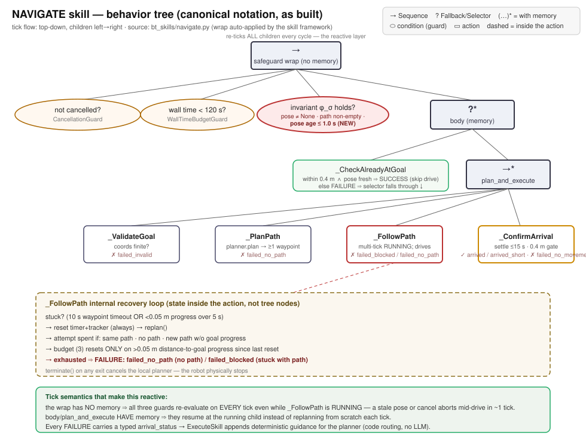
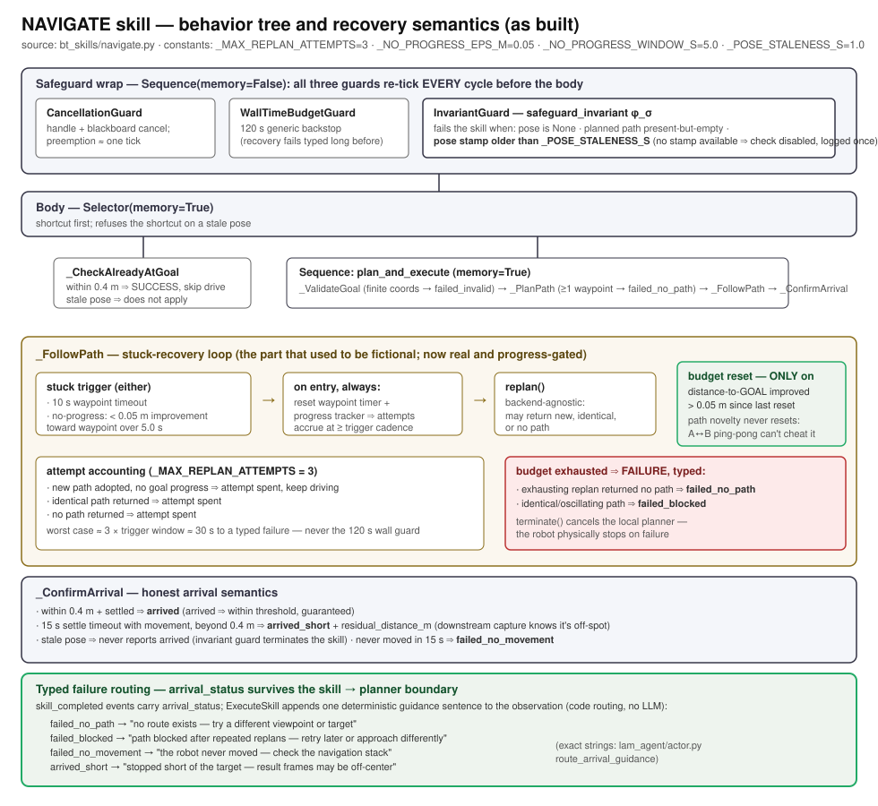

# NAVIGATE

Move the robot to an object identified by QUERY. Plans a path and drives
waypoint-by-waypoint to the object's best viewing position.

Behavior tree (canonical notation):


Recovery semantics and failure typology in detail:


## When to Use

- After QUERY returned a handle (e.g., `red_umbrella_1`).
- To physically approach a target before visual inspection or capture.
- For exploration targets: navigate near the suggested anchor area.

## Parameters

| Parameter | Required | Description |
|-----------|----------|-------------|
| `target_object` | yes | Handle from QUERY (e.g. `red_umbrella_1`). |
| `viewpoint_index` | no | 0-based index into the target's viewpoint list. Default 0 (first viewpoint). All indices are equally valid, there is no "primary". Pick by `total_viewpoints` in result_data, or by the alternatives surfaced in the `already_at_goal` observation. |

## Behavior Tree

The framework auto-wraps the body inside a safeguarding Sequence
(see [Safeguarding] below). The body itself:

```
NavigateSkill body (Selector, memory=True)
├── check_already_at_goal — SUCCESS shortcut when robot is at goal AND stationary
└── Sequence(navigate_plan_and_execute, memory=True)
    ├── validate_goal       — check coordinates finite, planner has map
    ├── plan_path           — Dijkstra/A* → waypoint list
    ├── follow_path         — send waypoints to local planner, monitor progress
    │                          (multi-tick: RUNNING until all waypoints reached or failure)
    └── confirm_arrival     — wait for robot to settle near goal, set result_data
```

## Subtree Leaves (failure tags)

When a skill fails, `handle.observation` is prefixed `[leaf=<name>]`
identifying which child returned FAILURE.

| Leaf | What FAILURE means | Recovery hint |
|------|---------------------|---------------|
| `check_already_at_goal` | Internal-only; never reported as a leaf failure. Returning FAILURE here simply means "shortcut doesn't apply, run the full nav". | — |
| `validate_goal`  | Goal coordinates not finite (NaN/inf). Bad pose computation or stale viewpoint data. | Re-QUERY the target; verify `viewpoint_index`. |
| `plan_path`      | Dijkstra/A* found no path from current pose to target — target unreachable from here. | Re-NAVIGATE; consider a different viewpoint. |
| `follow_path`    | Stuck (10 s waypoint timeout OR <0.05 m progress over 5 s) and the replan budget (3 attempts, reset only on >0.05 m distance-to-goal progress) is exhausted. `arrival_status` distinguishes `failed_blocked` (replans kept returning a usable-but-unhelpful path) from `failed_no_path` (the exhausting replan found no path at all). | `failed_no_path`: different viewpoint/target. `failed_blocked`: retry later or approach differently. |
| `confirm_arrival` | 15 s settle timeout without the robot ever starting to move (`failed_no_movement`) — the local planner never accepted the goal. A settle timeout *with* movement but beyond 0.4 m reports SUCCESS with `arrival_status="arrived_short"` + `residual_distance_m` instead of a clean `arrived`. A stale pose (stamp older than 1 s) never produces `arrived` — the invariant guard terminates the skill instead. | Re-NAVIGATE; consider a different viewpoint. |

Wrap-level failure tags (framework, all skills):

| Leaf | What it means |
|------|----------------|
| `CancellationGuard`   | Skill cancelled by the BT (preemption). |
| `WallTimeBudgetGuard` | Skill exceeded its wall-time budget. |
| `InvariantGuard`      | `safeguard_invariant` returned False. See [Safeguarding]. |

## Safeguarding

Framework wrap:

```
Sequence(memory=False, [
    CancellationGuard,
    WallTimeBudgetGuard,
    InvariantGuard,
    <body subtree above>,
])
```

`safeguard_invariant` returns False (aborting within one tick) when:

- `state.robot_position is None` — localization lost.
- `handle.result_data["planned_path"]` exists and is empty — the path
  computed by `plan_path` has been invalidated.

Recovery: re-QUERY then NAVIGATE again.

## Outcomes

| Status | arrival_status | Observation |
|--------|---------------|-------------|
| Already at goal | `already_at_goal` | "Already at 'red umbrella' (0.18m from goal, viewpoint 0/3). Alternative viewpoints ≥1m away: idx 1 (1.4m), idx 2 (2.1m). Pass viewpoint_index=<idx> to try a different vantage." |
| Arrived | `arrived` | "Arrived at 'red umbrella'." |
| No path | `failed_no_path` | "No path to 'red umbrella'. Target may be unreachable." |
| Blocked | `failed_blocked` | "Navigation blocked after replan attempts." |
| No movement | `failed_no_movement` | "Robot never started moving (waited 15.0s)." |
| Invalid | `failed_invalid` | "Invalid goal coordinates." |

The `already_at_goal` shortcut fires when the robot is within 0.4 m of the
goal AND below settling-velocity thresholds. It scans `all_viewpoints` on
the target object and recommends any sibling viewpoint at least 1 m from
the current one. This can be useful when a re-NAVIGATE is needed to get a different
view of the same target.

## Result Data

```json
{
    "arrival_status": "arrived",
    "target_handle": "red_umbrella_1",
    "target_label": "red umbrella",
    "viewpoint_index": 0,
    "total_viewpoints": 3,
    "is_exploration": false,
    "goal": {"x": 1.5, "y": 2.5, "theta": 0.3}
}
```

## Gating

- `requires_query = True` — QUERY must succeed first.

## Viewpoint Retry Pattern

If visual verification fails after NAVIGATE, try an alternative viewpoint:

```
NAVIGATE(target="red_umbrella_1")                    → arrived (viewpoint 0/N)
SURROUND_SURVEY("is the red umbrella visible?")       → "not visible from here"
NAVIGATE(target="red_umbrella_1", viewpoint_index=1)  → arrived (viewpoint 1/N)
SURROUND_SURVEY("is the red umbrella visible?")       → "visible in frontright camera"
```

## Typical Sequence

```
QUERY("red umbrella") → handle "red_umbrella_1"
  → NAVIGATE("red_umbrella_1")           ← this skill
    → SURROUND_SURVEY("red umbrella visible?")
      → CAPTURE(camera="frontright")
```
